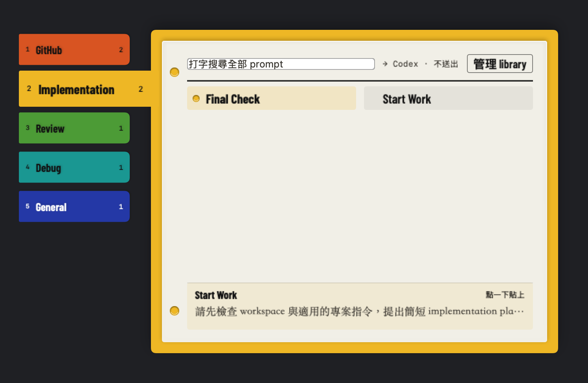
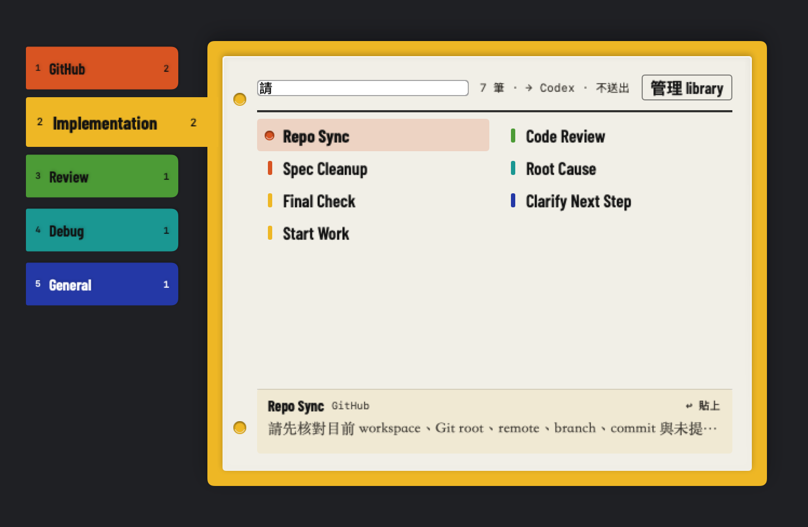
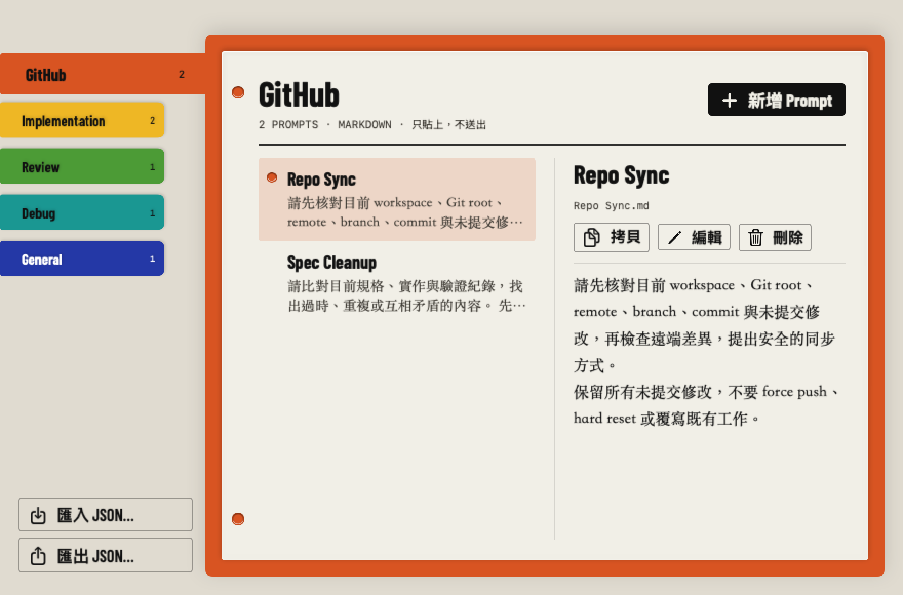

# Prompt Wheel

**English** · [繁體中文](README.zh-TW.md)

**Your best prompts, one keystroke away — in any app on your Mac.**

Press **⌥ Space** in any text field, pick a prompt, and Prompt Wheel pastes it right where your cursor was. Exactly once, and never sent. Your library is just a folder of Markdown files you own.



| Type to search every prompt | Manage your library |
| --- | --- |
|  |  |

<sub>Screenshots show the sample prompts that ship with the app.</sub>

## Why Prompt Wheel

If you work all day in Codex, ChatGPT, Claude or your editor, you type the same instructions over and over: *start work*, *review this diff*, *find the root cause*, *final check*. Prompt Wheel keeps them in one place and puts them back into whichever app you are typing in, without leaving it.

- **Appears at your pointer.** A small panel opens next to the mouse, over any app, on any Space, including full-screen apps.
- **Hover to browse.** Each category is a colour tab. Rest the pointer on a tab and its prompts appear; click a prompt to paste it.
- **Type to search.** Start typing as soon as the panel opens to search titles and text across every category. Input methods such as Zhuyin and Pinyin work.
- **Pastes once, never sends.** Prompt Wheel sends a single ⌘V to the app you came from. It never presses Return, so you can edit before you send.
- **Your files, verbatim.** Categories are folders and prompts are `.md` files. Line breaks and code fences are pasted exactly as written.
- **Stays out of the way.** Drag the panel aside and it reopens there next time. It lives in the menu bar, not the Dock.
- **Built-in library manager.** Create, edit, recategorise and delete prompts, or import and export the whole library as JSON.
- **Native and small.** SwiftUI + AppKit, no third-party dependencies, no network access.

## Install

Prompt Wheel is currently distributed as source. Building it takes about a minute.

**Requirements**

- macOS 15.2 or later
- Xcode, or the Xcode Command Line Tools with Swift 6 (`xcode-select --install`)

**1. Build**

```bash
git clone https://github.com/kevcltsai/prompt-wheel.git
```

```bash
cd prompt-wheel && ./scripts/build.sh
```

This creates `dist/Prompt Wheel.app`, signed locally (ad hoc).

**2. Move it to Applications**

```bash
mkdir -p ~/Applications && ditto "dist/Prompt Wheel.app" ~/Applications/"Prompt Wheel.app"
```

```bash
open ~/Applications/"Prompt Wheel.app"
```

A speech-bubble icon appears in the menu bar.

**3. Allow pasting (Accessibility)**

Prompt Wheel needs Accessibility permission to paste into other apps.

1. Click the menu-bar icon and choose **Enable Accessibility…**.
2. In **System Settings → Privacy & Security → Accessibility**, turn on **Prompt Wheel**. If it is not listed, click **+** and add `~/Applications/Prompt Wheel.app`.
3. Quit Prompt Wheel from its menu and open it again.

The menu now shows **Accessibility: Granted…**.

### Updating

Quit Prompt Wheel, pull, rebuild and copy the app again (steps 1–2). Each local build is signed differently, so macOS treats it as a new app. Remove the old **Prompt Wheel** entry under Accessibility, add the new one, and relaunch.

To avoid granting permission after every update, create a self-signed **Code Signing** certificate in Keychain Access and build with it:

```bash
PROMPT_WHEEL_SIGNING_IDENTITY="Your Certificate Name" ./scripts/build.sh
```

### Uninstalling

Quit Prompt Wheel and delete `~/Applications/Prompt Wheel.app`. Your prompts stay in `~/Library/Application Support/Prompt Wheel/Prompts/`. Delete that folder only if you no longer want them.

## Using Prompt Wheel

1. Click into a text field in Codex, ChatGPT, Claude or any other app.
2. Press **⌥ Space**. The panel opens with the first category tab under your pointer.
3. Rest the pointer on a category tab to open it, or click it.
4. Move over a prompt to see a summary in the preview strip, then **click** it to paste.

| Key | Action |
| --- | --- |
| Type | Search every prompt |
| ← / → | Previous / next category |
| 1–9 | Jump to a category |
| ↑ / ↓ | Select a prompt |
| Return (on release) | Paste the selected prompt |
| Esc | Clear the search, then close |

**Moving the panel:** drag the top row or the coloured border. Prompt Wheel remembers where you left it on that display. Choose **Reset Picker Position** from the menu to go back to opening at the pointer.

**Manage Prompt Library…** in the menu bar opens a separate window where you can add, edit, recategorise, copy and delete prompts, and import or export JSON.

### ⌥ Space is already taken

ChatGPT for macOS also uses ⌥ Space by default. If Prompt Wheel cannot register the shortcut, its menu shows a warning with the error code. Change the shortcut in the other app, then choose **Retry Global Hotkey**. You can always open the panel from **Open Prompt Wheel** in the menu. The shortcut is fixed to ⌥ Space in this version.

## Your prompt library

On first launch, Prompt Wheel copies the sample prompts to:

```text
~/Library/Application Support/Prompt Wheel/Prompts/
├── GitHub/
│   ├── Repo Sync.md
│   └── Spec Cleanup.md
├── Implementation/
│   ├── Start Work.md
│   └── Final Check.md
├── Review/Code Review.md
├── Debug/Root Cause.md
└── General/Clarify Next Step.md
```

- Each top-level folder is a **category**. Each `.md` file is a **prompt**. The file name, without `.md`, is its **title**.
- The file's UTF-8 text is pasted verbatim, with no rendering or trimming.
- Hidden files, non-`.md` files and deeper subfolders are ignored.
- The folder is rescanned each time the panel opens, so edits in your own editor show up immediately.
- An existing library is never overwritten. Use **Choose Prompt Folder…** to point Prompt Wheel at another folder, for example one you sync.
- Import skips any prompt whose category and title already exist. The JSON format is an array of `{ "category", "title", "body" }`.

## Clipboard

Pasting places the prompt on the clipboard. It stays there by default.

Turn on **Restore Clipboard after Paste** in the menu to put your previous clipboard back about 0.9 seconds after pasting. All readable formats are saved first. The restore is skipped if you copy something new in the meantime. Some apps read the clipboard slowly, so this setting is off by default.

## Privacy

Prompt Wheel makes no network connections and collects nothing. It reads your prompt folder, and when you choose a prompt it writes that prompt to the clipboard and sends one ⌘V to the app you were using.

## Development

```bash
./scripts/test.sh
```

```bash
./scripts/build.sh
```

The checks run without Xcode's test runner. They use temporary folders and a private pasteboard and never touch your real clipboard. Launch the built `.app` rather than `swift run`; the bare binary has no bundled prompts or fonts.

Design notes are in [DESIGN.md](DESIGN.md) and the product brief is in [PRODUCT.md](PRODUCT.md).

## License

[MIT](LICENSE). The bundled Barlow Condensed font is licensed under the SIL Open Font License 1.1; see [`App/Fonts/OFL.txt`](App/Fonts/OFL.txt).
